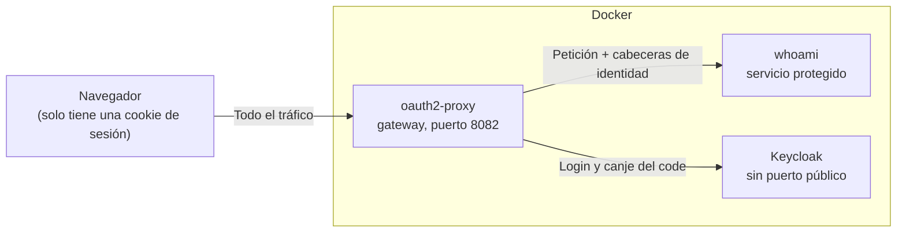

<br/><br/>


# Laboratorio 4: Autenticación en el borde con un gateway

*Curso de Identidad Digital, Autenticación y Autorización — Módulo 3: Federación, JWT y autenticación
en microservicios.*

## Objetivos

En el laboratorio anterior, la propia aplicación se encargaba del diálogo con el servidor de
identidad, y los *tokens* acababan en manos del navegador. Esa disposición, útil para entender el
mecanismo, no es la que se emplea en producción. En una arquitectura de microservicios lo habitual es
concentrar la autenticación en un único punto situado en el **borde** del sistema —un *gateway*—, de
modo que los servicios internos no tengan que implementar OAuth. Esta práctica monta esa disposición y
permite comprobar su efecto más característico: un servicio que recibe la identidad del usuario sin
haber implementado una sola línea de autenticación.

Al finalizar la práctica, el estudiante será capaz de:

- Explicar el patrón de autenticación en el borde y qué implica que un servicio interno reciba la
  identidad del usuario en cabeceras HTTP.
- Desplegar un *gateway* (`oauth2-proxy`) que realice el flujo OAuth en nombre de un servicio
  protegido, como cliente confidencial de Keycloak.
- Comprender por qué un servicio interno (Keycloak incluido) puede no necesitar exponer ningún puerto
  al exterior.
- Distinguir entre la validación local de una sesión y la dependencia del proveedor de identidad.

## Dependencias

Para realizar la práctica, el alumno deberá tener instalado en su ordenador:

- **Docker** y **Docker Compose** ([instalación](https://docs.docker.com/get-docker/)).
- El puerto **8082** libre.
- La herramienta `openssl`, presente en cualquier distribución de Linux.
- Cualquier navegador moderno (Chrome, Edge, Chromium o Firefox).

La práctica es independiente de los laboratorios anteriores: el entorno arranca con su propio
Keycloak.

## Descripción de la práctica

El escenario se compone de tres piezas. La primera es **`whoami`**, un servicio de demostración cuya
única función es responder a cada petición con un volcado de todas las cabeceras HTTP que ha
recibido; hace las veces del servicio de negocio que se quiere proteger, y no sabe nada de
autenticación. La segunda es **Keycloak**, el servidor de identidad. Y la tercera, la central, es
**`oauth2-proxy`**, el *gateway*: un proxy inverso que, antes de dejar pasar una petición hacia
`whoami`, comprueba que exista una sesión válida y, si es así, añade a la petición unas cabeceras con
la identidad del usuario.

A diferencia del laboratorio anterior, aquí el navegador nunca recibe los *tokens*. Es el *gateway*
quien realiza el flujo OAuth con Keycloak, quien guarda los *tokens* y quien entrega al navegador, a
cambio, una simple **cookie de sesión** firmada por él mismo.



Hay un detalle del esquema que conviene asimilar antes de empezar, porque es lo que más desconcierta:
en el `docker-compose.yml`, **ni `keycloak` ni `whoami` publican ningún puerto**. Es decir, el
navegador no puede comunicarse con ellos directamente; no existe un `localhost:8080` en esta
práctica. El único puerto accesible desde el exterior es el **8082**, el del *gateway*, y todo el
tráfico —incluido el acceso a la propia consola de administración de Keycloak y a su pantalla de
*login*— pasa a través de él. Esto reproduce una disposición de producción, en la que el proveedor de
identidad y los servicios internos viven en una red privada y no se exponen al público.

---

## 1. Puesta en marcha

Copie el fichero de configuración:

```bash
cp .env.example .env
```

El *gateway* necesita un secreto para firmar sus cookies de sesión. Genérelo y cópielo en `.env`, en
la variable `OAUTH2_PROXY_COOKIE_SECRET`. Debe estar codificado en base64 *URL-safe*, de ahí la
transformación final con `tr`:

```bash
openssl rand -base64 32 | tr '+/' '-_'
```

Levante a continuación todo el conjunto de servicios:

```bash
docker compose up -d
```

Al arrancar, Keycloak **importa** el fichero `realm/realm-curso.json`, que crea un realm `curso` con un
único usuario, `diego` (contraseña `diego`). Espere a que Keycloak indique `healthy` (`docker compose
ps`; la primera vez puede tardar entre 30 y 40 segundos) y confirme que todo funciona accediendo a
`http://localhost:8082/admin/master/console/`, que debe mostrar la pantalla de inicio de sesión de la
consola de Keycloak.

> **Pregunta 1.1.** Si Keycloak no publica ningún puerto, ¿cómo consigue el navegador llegar a su pantalla
> de inicio de sesión?

---

## 2. Registro del gateway como cliente confidencial

El *gateway* va a realizar el flujo OAuth en nombre de `whoami`, así que debe estar registrado en
Keycloak como cliente. Todo se hace desde la consola de administración, a la que se accede —como todo
lo demás— a través del puerto del *gateway*.

1. **Acceda a la consola:** `http://localhost:8082/admin/master/console/` con las credenciales de
   `.env` (`admin` / `admin`).

   > **Nota.** Esto funciona sin haber configurado todavía nada del *gateway* porque la ruta
   > `/admin/*` está exenta de requerir su sesión. La consola de Keycloak tiene su propio inicio de
   > sesión, independiente del que se va a montar para proteger `whoami`.

   > **Nota.** La consola se abre en el realm `master`. Cambie al realm `curso` desde el menú lateral
   > → **Manage realms** → `curso`, y compruebe que arriba a la izquierda aparece `curso` *Current realm*.
   > Si crea el cliente en `master`, el inicio de sesión fallará porque el realm no es el correcto.

2. **Cree el cliente confidencial:** realm `curso` → **Clients** → **Create client**.
   - Client ID = `gateway` → Next.
   - **Client authentication = ON** (confidencial, con secreto), **Standard flow = ON**, resto OFF →
     Next.
   - **Valid redirect URIs** = `http://localhost:8082/oauth2/callback` → Save.
3. **Copie el secreto:** pestaña **Credentials** del cliente `gateway` → copie el **Client secret** →
   péguelo en `.env`, en la variable `OAUTH2_PROXY_CLIENT_SECRET` (sustituyendo el valor
   `placeholder-temporal`).
4. **Reinicie el *gateway*** para que incorpore el secreto real:
   ```bash
   docker compose up -d oauth2-proxy
   ```

> **Pregunta 2.1.** ¿Por qué este cliente se declara **confidencial**, cuando el del laboratorio anterior
> era público?

---

## 3. Prueba sin sesión y con sesión

Con todo configurado, se comprueba el comportamiento del *gateway* ante una petición no autenticada y
ante una autenticada:

1. **Sin sesión:** abra `http://localhost:8082/` en una ventana de incógnito. El *gateway* no deja
   pasar la petición: responde con una redirección a la pantalla de inicio de sesión de Keycloak.
2. **Con sesión:** inicie sesión como `diego` (contraseña `diego`). Tras regresar, `whoami` responde
   con un volcado de todas las cabeceras HTTP que ha recibido.

---

## 4. Las cabeceras de identidad

Examine el volcado que ha devuelto `whoami` y localice las siguientes cabeceras, que el usuario no ha
añadido en ningún momento:

- `X-Forwarded-User`: el identificador único de Diego en Keycloak (el *claim* `sub`).
- `X-Forwarded-Preferred-Username` y `X-Forwarded-Email`: su nombre de usuario y su correo.
- `X-Forwarded-Groups`: sus roles.
- `X-Forwarded-Access-Token`: el access token completo, para que el servicio pueda, si lo necesita,
  llamar a otras APIs en nombre de Diego.

Aquí está el núcleo de la práctica. `whoami` desconoce por completo qué es OAuth, qué es un realm o
qué es un *token*; se limita a recibir unas cabeceras HTTP corrientes, como cualquier servicio. Toda
la complejidad de la autenticación se ha quedado en el borde, en el *gateway*, y no se ha propagado al
servicio interno. Y todo ello ha sucedido sin que Keycloak haya tenido en ningún momento un puerto
abierto al exterior.

> **Pregunta 4.1.** `whoami` recibe la identidad del usuario sin saber nada de OAuth. ¿Qué implicaría esto
> si en lugar de un `whoami` hubiera 50 microservicios distintos?

> **Pregunta 4.2.** `whoami` da por buena la identidad que le llega en `X-Forwarded-User` sin comprobar
> nada. ¿Qué ocurriría si alguien pudiera enviarle peticiones directamente, sin pasar por el
> *gateway*? ¿Qué lo impide en este montaje, y qué más podría hacer el servicio para no fiarse a
> ciegas?

---

## 5. Verificación: la cookie y el proveedor de identidad

En esta arquitectura el navegador no tiene ningún *token* que manipular; lo que posee es la **cookie
de sesión** del *gateway*. La verificación actúa, por tanto, sobre esa cookie y sobre la dependencia
del proveedor de identidad.

1. **Manipular la cookie:** DevTools → **Application** (en Firefox, **Almacenamiento**) → **Cookies**
   → localice la cookie `_oauth2_proxy` → modifique un carácter cualquiera de su valor → recargue
   `http://localhost:8082/`. El *gateway* vuelve a tratar la petición como si no hubiera sesión y
   redirige al inicio de sesión de Keycloak. Inicie sesión de nuevo como `diego` antes de seguir.
2. **Detener el proveedor de identidad:**
   ```bash
   docker compose stop keycloak
   ```
   - Recargue `http://localhost:8082/` en la ventana en la que ya tenía la sesión iniciada: `whoami`
     sigue respondiendo con normalidad.
   - Abra una ventana de incógnito **nueva** y acceda a `http://localhost:8082/`: el *gateway*
     intenta llevarle al inicio de sesión, pero la respuesta es un error **502**, porque esa pantalla
     la sirve Keycloak, que ya no está disponible.

   Vuelva a arrancarlo a continuación:
   ```bash
   docker compose start keycloak
   ```

> **Pregunta 5.1.** Al modificar un solo carácter de la cookie, el *gateway* la rechaza. ¿Por qué no puede
> un usuario fabricarse una cookie válida, por ejemplo con la identidad de otra persona? Relaciónelo
> con el secreto generado en el apartado 1.

> **Pregunta 5.2.** Detener Keycloak no afecta a quien ya tenía la sesión iniciada, pero sí impide
> acceder a quien entra de nuevo. ¿A qué se debe esa diferencia?

---

## Resolución de problemas

- El inicio de sesión falla con un error de credenciales de cliente → se ha omitido el paso 4 del
  apartado 2 (reiniciar `oauth2-proxy` tras copiar el secreto real), y el *gateway* sigue usando
  `placeholder-temporal`.
- `oauth2-proxy` no arranca y muestra `cookie_secret must be 16, 24, or 32 bytes` → el secreto de
  cookie se pegó sin aplicar `tr '+/' '-_'` y contenía un `+` o una `/`. Genérelo de nuevo.
- `oauth2-proxy` no arranca y muestra `missing setting: client-secret` → la variable
  `OAUTH2_PROXY_CLIENT_SECRET` de `.env` está vacía. Debe contener `placeholder-temporal` o el secreto
  real del cliente.
- La consola de Keycloak no responde → en el primer arranque tarda entre 30 y 40 segundos en alcanzar
  el estado `healthy`. Espere.
- Para reiniciar el entorno desde cero (se pierde el cliente creado y el realm se vuelve a importar):
  `docker compose down -v && docker compose up -d`. Después habrá que repetir el apartado 2.
